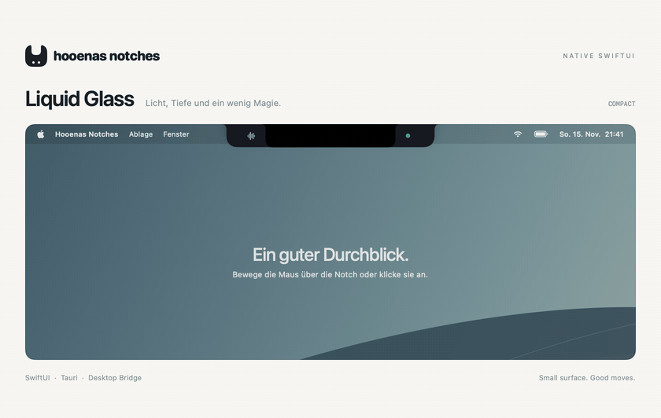

# Hooenas Notches SDK

Animated native notches for macOS apps. Add your own SwiftUI content, present a
surface at the physical top of the screen, or control the native renderer from a
Tauri frontend through a typed TypeScript client.

## Surfaces

| Contour                                                   | Capsule                                                 | Liquid Glass                                            |
| --------------------------------------------------------- | ------------------------------------------------------- | ------------------------------------------------------- |
| Soft shoulders, an indigo contour and a graphite surface. | A rounded silhouette attached to the screen's top edge. | A translucent material with a subtle outline.           |
|       |     |  |

All three share the same content API, `spring`, `gentle` and `snappy` motion
presets, hover expansion, click expansion and Escape to collapse. Reduce Motion
uses a brief ease-out transition, removes hover scaling and pauses continuous
status animations.

## Requirements

- macOS 14 or newer.
- Swift 6.2 or newer for the Swift package and native helper.
- Node.js 22 or newer for the optional TypeScript client.
- The Tauri example also needs Rust and Node.js 22.12 or newer.

The renderer uses SwiftUI and AppKit. The supplied desktop bridge runs on macOS;
the TypeScript protocol layer can be imported independently of Tauri.

## Install with Swift Package Manager

Add SDK **0.2.0** to your package dependencies:

```swift
.package(
    url: "https://github.com/openhoo/hooenas-notches-sdk.git",
    from: "0.2.0"
)
```

Add the product to your app target:

```swift
.product(name: "HooenasNotches", package: "hooenas-notches-sdk")
```

`HooenasNotchesProtocol` is a separate product for Swift hosts that only need the
JSON-lines protocol types and validation.

### Use a local checkout

For local development, place this checkout next to your app package and replace
the remote dependency with:

```swift
.package(path: "../hooenas-notches-sdk")
```

The examples below use the 0.2.0 API. Apps staying on 0.1.1 can use the
[tagged 0.1.1 documentation](https://github.com/openhoo/hooenas-notches-sdk/blob/v0.1.1/README.md).

## SwiftUI content

Use the notch inline in any SwiftUI layout. The compact slot acts as the expand
button; the expanded slot accepts your own controls.

```swift
import SwiftUI
import HooenasNotches

struct UploadNotch: View {
    @State private var expanded = false

    var body: some View {
        HooenasNotch(
            style: .contour,
            isExpanded: $expanded,
            motion: .spring
        ) {
            HStack {
                NotchActivityIndicator(activity: .working, tint: .mint)
                Spacer()
                Text("64%").font(.caption.monospacedDigit())
            }
        } expanded: {
            VStack(alignment: .leading, spacing: 16) {
                Text("Uploading your files").font(.headline)
                ProgressView(value: 0.64).tint(.mint)
                Button("Cancel") { expanded = false }
            }
        }
    }
}
```

For compact content with an overlay, use `NotchCompactWings` to reserve the
camera gap automatically. Each slot can hold a short symbol, label or value;
the compact notch remains one accessible button.

## Native screen overlay

`NotchPanelController` hosts the view in a transparent AppKit panel. It centers
the surface on the selected display's physical top edge and reserves space for
its camera housing. Keep the controller and the expansion state alive for as
long as the overlay should exist. The binding-based overload keeps the notch
and its click target in sync. This overload was added in 0.2.0. For 0.1.1, use the [content-based overlay example](https://github.com/openhoo/hooenas-notches-sdk/blob/v0.1.1/README.md#native-screen-overlay).

```swift
import SwiftUI
import HooenasNotches

struct ScreenNotch: View {
    @State private var panel = NotchPanelController()
    @State private var expanded = false

    var body: some View {
        HStack {
            Button("Show notch", action: show)
            Button("Open and focus") {
                expanded = true
                show()
                panel.focus()
            }
            Button("Hide notch", action: panel.hide)
        }
        .onDisappear(perform: panel.hide)
    }

    private func show() {
        panel.show(
            configuration: NotchConfiguration(expandedSize: CGSize(width: 480, height: 240)),
            style: .contour,
            isExpanded: $expanded,
            hoverOpens: false
        ) {
            NotchCompactWings {
                Image(systemName: "timer").accessibilityHidden(true)
            } trailing: {
                Text("14:30").accessibilityLabel("14 minutes, 30 seconds left")
            }
        } expanded: {
            ScrollView {
                VStack(alignment: .leading, spacing: 12) {
                    Text("Focus session").font(.headline)
                    ProgressView(value: 0.42)
                    Text("Your next break is in 14 minutes.")
                }
                .frame(maxWidth: .infinity, alignment: .leading)
            }
        }
    }
}
```

Call `show()` again to change size, motion or appearance. For an observable
custom wrapper whose content changes while the panel is visible, use
`show(content:configuration:style:screen:isExpanded:)` or `update(...)` and
pass the same style, configuration and state to the view and panel. Use
`screen:` to choose an `NSScreen`; refreshes preserve the native hosting view
and text editor focus.

Showing the panel does not activate the app. Pointer events outside the visible
shape pass through. Use `focus()` for a deliberate keyboard action, and provide
a focused control in your expanded view if the action should begin editing.
`NotchAccessibilityLabels` accepts localized text for the expand hint, collapse
button and accessibility state. `layoutSnapshot` exposes the screen, panel and
hosting-view frames for placement diagnostics.

## Geometry and content spacing

```swift
let configuration = NotchConfiguration(
    collapsedSize: CGSize(width: 204, height: 32),
    expandedSize: CGSize(width: 640, height: 219),
    collapsedTopRadius: 8,
    collapsedBottomRadius: 16,
    expandedTopRadius: 22,
    expandedBottomRadius: 28,
    contentInsets: NotchContentInsets(
        top: 44, leading: 34, bottom: 20, trailing: 34
    ),
    automaticallyPadsCamera: true
)
```

The native overlay widens its compact state to leave room on both sides of a
camera housing. Expanded content gets at least the display's top safe area plus
12 points when space permits. Set `automaticallyPadsCamera: false` when you
provide your own camera aware layout. The overlay fits the requested dimensions
to the selected display. For an inline preview, call
`configuration.fitting(in: containerSize)`. `expandedContentSize` reports the
remaining space after the resolved insets. Arrange adaptive content using
`ViewThatFits`, a grid or a scroll view rather than tying controls to the
requested size. `panel.configuration` exposes the applied dimensions.

See [notch recipes](docs/recipes.md) for a resizable two-card example and ways
to map common app workflows to the compact and expanded surface.

## TypeScript and Tauri

The repository includes a working Tauri v2 app in [`examples/tauri`](examples/tauri)
and the client package in [`packages/client`](packages/client). The webview sends
state; the bundled `hooenas-notches-host` process draws the native overlay.

The client is available from this repository as a local package. It has not been
published to npm. The included Tauri app uses a `file:../../packages/client`
dependency. The sizing check below uses the 0.2.0 client.
When the bundled host is older, the capability is absent and its default size
continues to work.

```ts
import { createTauriNotch } from "@hooenas-notches/client/tauri";

const notch = await createTauriNotch();

notch.onAction(async (actionId) => {
  if (actionId === "cancel") {
    await notch.update({ activity: "idle", progress: null, subtitle: "Cancelled" });
  }
});

await notch.show({
  style: "contour",
  motion: "spring",
  expanded: true,
  title: "Uploading your files",
  subtitle: "3 of 8 files",
  activity: "working",
  progress: 0.375,
  actions: [{ id: "cancel", label: "Cancel" }],
});

await notch.update({ progress: 1, activity: "success", subtitle: "All done" });
if (notch.capabilities.includes("expanded-size")) {
  await notch.update({ expandedSize: { width: 520, height: 240 } });
}
await notch.hide();
await notch.quit();
```

Run the complete example:

```sh
npm --prefix packages/client ci
npm --prefix packages/client run build
npm --prefix examples/tauri ci
npm --prefix examples/tauri run tauri:dev
```

Its build hook compiles and bundles the Swift helper for the Rust target's
architecture. The example includes scoped shell capabilities and native action
callbacks. See the [Tauri guide](examples/tauri/README.md) for bundling details.

`NotchClient` also accepts a transport that you implement for another desktop
runtime. Launch the helper with `--stdio`, attach listeners before waiting for
`ready`, and keep stdin open. The protocol supports `show`, `update`, `hide`,
`quit`, action IDs and state events. See the [client API](packages/client/README.md)
and [host protocol](docs/host-protocol.md).

## Run the Swift showcase

```sh
swift run HooenasNotchesShowcase
```

The SDK showcase has an inline preview, all surfaces and motion presets,
activity and progress controls, width and height sliders, and a button for the
real screen overlay. Its source is in
[`Sources/HooenasNotchesShowcase`](Sources/HooenasNotchesShowcase).

## Development

```sh
./scripts/check.sh
```

The same macOS gate runs in GitHub Actions: Swift formatting, tests and release
builds with warnings as errors; client and real-host integration tests; Tauri
bundling and Clippy; and documentation/media validation. See
[CONTRIBUTING.md](CONTRIBUTING.md) for prerequisites and focused commands, and the
[changelog](CHANGELOG.md) for changes in each version.

Native tests inspect the actual panel, hosting view, editor focus, accessibility
and rendered top pixels on a Mac with a desktop display. Tests that need a
missing display report a skip. The real-host integration requires the release
helper; the complete gate builds it before running that test.

## License and provenance

The SDK is distributed under **FSL-1.1-MIT**. Its Contour shape is adapted from
the Cua Spaces notch, with custom cubic curves, softer radii, a new surface and
independent motion values. Upstream copyright and license notices are retained.

The adapted Cua source is subject to the FSL terms today. Its future MIT grant
applies on the second anniversary of the relevant upstream version's release.
See [`LICENSE`](LICENSE), [`THIRD_PARTY_NOTICES.md`](THIRD_PARTY_NOTICES.md) and the
[preserved upstream license](LICENSES/Cua-Spaces-Notch-LICENSE.txt).
