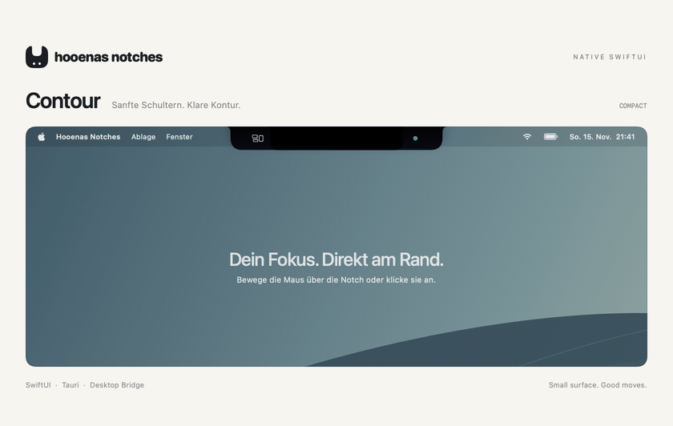
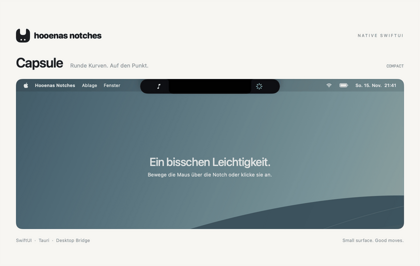

# Hooenas Notches SDK

Animated native notches for macOS apps. Add your own SwiftUI content, present a
surface at the physical top of the screen, or control the native renderer from a
Tauri frontend through a typed TypeScript client.

## Surfaces

| Contour                                                   | Capsule                                                 | Liquid Glass                                            |
| --------------------------------------------------------- | ------------------------------------------------------- | ------------------------------------------------------- |
| Soft shoulders, an indigo contour and a graphite surface. | A rounded silhouette attached to the screen's top edge. | A translucent material with a subtle outline.           |
|       |     |  |

All three share the same content API, `spring`, `gentle` and `snappy` motion
presets, hover expansion, click expansion and Escape to collapse. Reduce Motion
uses a short fade and pauses continuous status animations.

## Requirements

- macOS 14 or newer.
- Swift 6.2 or newer for the Swift package and native helper.
- Node.js 22 or newer for the optional TypeScript client.
- The Tauri example also needs Rust and Node.js 22.12 or newer.

The renderer uses SwiftUI and AppKit. The supplied desktop bridge runs on macOS;
the TypeScript protocol layer can be imported independently of Tauri.

## Install with Swift Package Manager

Add the public SDK repository to your package dependencies:

```swift
.package(
    url: "https://github.com/openhoo/hooenas-notches-sdk.git",
    from: "0.1.1"
)
```

Add the product to your app target:

```swift
.product(name: "HooenasNotches", package: "hooenas-notches-sdk")
```

`HooenasNotchesProtocol` is a separate product for Swift hosts that only need the
JSON-lines protocol types and validation.

## SwiftUI content

Use the notch inline in any SwiftUI layout. The compact slot acts as the expand
button; the expanded slot accepts your own controls.

```swift
import SwiftUI
import HooenasNotches

struct UploadNotch: View {
    @State private var expanded = false

    var body: some View {
        HooenasNotch(
            style: .contour,
            isExpanded: $expanded,
            motion: .spring
        ) {
            HStack {
                NotchActivityIndicator(activity: .working, tint: .mint)
                Spacer()
                Text("64%").font(.caption.monospacedDigit())
            }
        } expanded: {
            VStack(alignment: .leading, spacing: 16) {
                Text("Uploading your files").font(.headline)
                ProgressView(value: 0.64).tint(.mint)
                Button("Cancel") { expanded = false }
            }
        }
    }
}
```

Compact content is intentionally arranged at the sides so it can flank a
MacBook camera housing. Inline views use the requested geometry directly.

## Native screen overlay

`NotchPanelController` hosts the view in a transparent AppKit panel. It centers
the surface on the selected display's physical top edge and reserves space for
its camera housing. Keep the controller and the expansion state alive for as
long as the overlay should exist.

```swift
import SwiftUI
import HooenasNotches

@MainActor
final class ScreenNotch: ObservableObject {
    private let panel = NotchPanelController()
    private let state = ScreenNotchState()

    func show() {
        panel.show(
            content: ScreenNotchContent(state: state),
            style: .contour,
            isExpanded: { [weak state = state] in state?.expanded ?? false }
        )
    }

    func hide() { panel.hide() }
}

private final class ScreenNotchState: ObservableObject {
    @Published var expanded = false
}

private struct ScreenNotchContent: View {
    @ObservedObject var state: ScreenNotchState

    var body: some View {
        HooenasNotch(isExpanded: $state.expanded) {
            HStack {
                NotchActivityIndicator(activity: .listening)
                Spacer()
                Image(systemName: "waveform")
            }
        } expanded: {
            Text("Listening for your next idea").font(.headline)
        }
    }
}
```

Store a `ScreenNotch` in your app, for example with `@StateObject`, and call
`show()` or `hide()` from your UI. Pass the same style and configuration to the
view and panel. Call `update(...)` to replace visible content or change geometry,
and use the `screen:` parameter to choose an `NSScreen`.

Showing the panel does not activate the app. Pointer events outside the visible
shape pass through. `layoutSnapshot` exposes the screen, panel and hosting-view
frames for placement diagnostics.

## Geometry and content spacing

```swift
let configuration = NotchConfiguration(
    collapsedSize: CGSize(width: 204, height: 32),
    expandedSize: CGSize(width: 640, height: 219),
    collapsedTopRadius: 8,
    collapsedBottomRadius: 16,
    expandedTopRadius: 22,
    expandedBottomRadius: 28,
    contentInsets: NotchContentInsets(
        top: 44, leading: 34, bottom: 20, trailing: 34
    ),
    automaticallyPadsCamera: true
)
```

The native overlay widens its compact state to leave room on both sides of a
camera housing. Expanded content gets at least the display's top safe area plus
12 points. Set `automaticallyPadsCamera: false` when you deliberately provide
your own camera-aware layout. Invalid dimensions and insets are normalized.

## TypeScript and Tauri

The repository includes a working Tauri v2 app in [`examples/tauri`](examples/tauri)
and the client package in [`packages/client`](packages/client). The webview sends
state; the bundled `hooenas-notches-host` process draws the native overlay.

The client is available from this repository as a local package. It has not been
published to npm. The included Tauri app uses a `file:../../packages/client`
dependency.

```ts
import { createTauriNotch } from "@hooenas-notches/client/tauri";

const notch = await createTauriNotch();

notch.onAction((actionId) => {
  if (actionId === "cancel") {
    void notch.update({ activity: "idle", progress: null, subtitle: "Cancelled" });
  }
});

await notch.show({
  style: "contour",
  motion: "spring",
  expanded: true,
  title: "Uploading your files",
  subtitle: "3 of 8 files",
  activity: "working",
  progress: 0.375,
  actions: [{ id: "cancel", label: "Cancel" }],
});

await notch.update({ progress: 1, activity: "success", subtitle: "All done" });
await notch.hide();
await notch.quit();
```

Run the complete example:

```sh
npm --prefix packages/client ci
npm --prefix packages/client run build
npm --prefix examples/tauri ci
npm --prefix examples/tauri run tauri:dev
```

Its build hook compiles and bundles the Swift helper for the Rust target's
architecture. The example includes scoped shell capabilities and native action
callbacks. See the [Tauri guide](examples/tauri/README.md) for bundling details.

`NotchClient` also accepts a transport that you implement for another desktop
runtime. Launch the helper with `--stdio`, attach listeners before waiting for
`ready`, and keep stdin open. The protocol supports `show`, `update`, `hide`,
`quit`, action IDs and state events. See the [client API](packages/client/README.md)
and [host protocol](docs/host-protocol.md).

## Run the Swift showcase

```sh
swift run HooenasNotchesShowcase
```

The small SDK showcase has an inline preview, all surfaces and motion presets,
activity and progress controls, and a button for the real screen overlay. Its
source is in [`Sources/HooenasNotchesShowcase`](Sources/HooenasNotchesShowcase).

## Development

```sh
./scripts/check.sh
```

The same macOS gate runs in GitHub Actions: Swift formatting, tests and release
builds with warnings as errors; client and real-host integration tests; Tauri
bundling and Clippy; and documentation/media validation. See
[CONTRIBUTING.md](CONTRIBUTING.md) for prerequisites and focused commands, and the
[changelog](CHANGELOG.md) for the reviewed 0.1.1 fixes.

Native tests inspect the actual panel, hosting view, editor focus, accessibility
and rendered top pixels on a Mac with a desktop display. Tests that need a
missing display report a skip. The real-host integration requires the release
helper; the complete gate builds it before running that test.

## License and provenance

The SDK is distributed under **FSL-1.1-MIT**. Its Contour shape is adapted from
the Cua Spaces notch, with custom cubic curves, softer radii, a new surface and
independent motion values. Upstream copyright and license notices are retained.

The adapted Cua source is subject to the FSL terms today. Its future MIT grant
applies on the second anniversary of the relevant upstream version's release.
See [`LICENSE`](LICENSE), [`THIRD_PARTY_NOTICES.md`](THIRD_PARTY_NOTICES.md) and the
[preserved upstream license](LICENSES/Cua-Spaces-Notch-LICENSE.txt).
